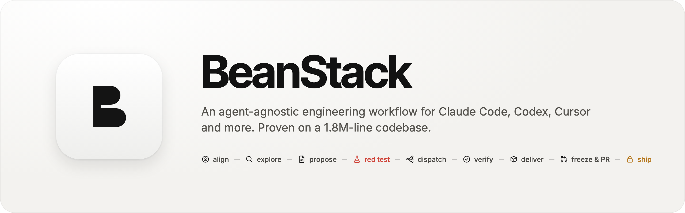
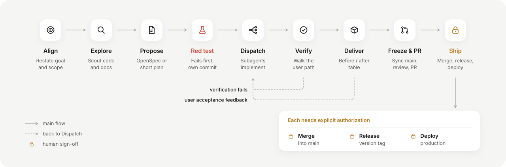
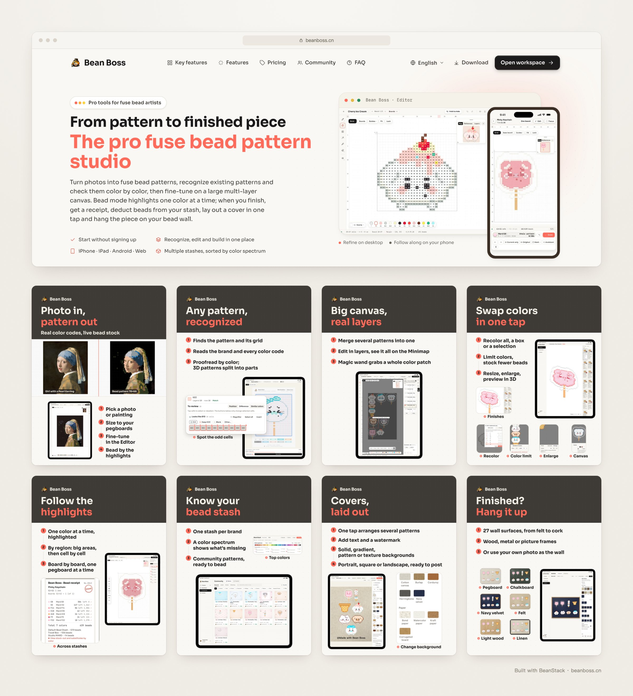
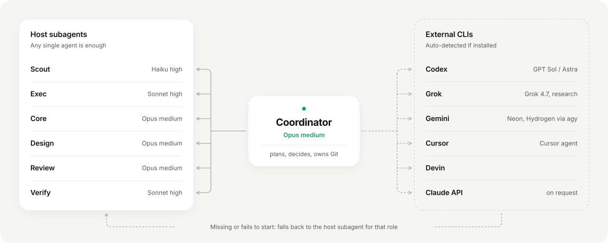

<p align="center">
  <picture>
    <source media="(prefers-color-scheme: dark)" srcset="assets/banner-dark.png">
    
  </picture>
</p>

<p align="center">
  <b>An agent-agnostic engineering workflow</b><br>
  Works with Claude Code, Codex, Cursor, or any agent that can read skill files and dispatch subagents
</p>

<p align="center">
  <a href="LICENSE"></a>
  
  
  
  
</p>

<p align="center">
  <b>English</b> · <a href="README.zh-CN.md">简体中文</a>
</p>

<br>

> [!NOTE]
> **In one sentence**: you state the requirement and accept the result. Everything in between (alignment, research, writing the spec, writing the test first, dispatching subagents, verifying in a real browser, writing the delivery summary) is run end to end by one coordinator leading a team of subagents.
>
> It is the workflow we have used every day for eight months to build [**Bean Boss**](https://beanboss.cn). Over that time the repository grew to **1.86M lines of source, 61,000 test cases and 919 merged PRs**.

<br>

**Contents**　[What it is](#what-it-is) · [Install](#install) · [A complete walkthrough](#a-complete-walkthrough) · [Deep dive: design and implementation](#deep-dive-design-and-implementation) · [Roadmap](#roadmap) · [Credits](#credits)

<br>

## What it is

BeanStack is an **Agent Skill**: one `SKILL.md` entry point, plus 11 reference documents loaded on demand and a few scripts. It is not tied to any one agent. Once the coordinator has read it, it knows how to break a task down, whom to hand each piece to, and what counts as proof that the work is done.

<p align="center"></p>

**The whole loop has six steps:**

| | Phase | What happens |
|:-:|---|---|
| 1 | **Align** | Restate the goal and the minimal change, supply the professional terms for what you described, and write down what will prove the result at acceptance |
| 2 | **Research → propose** | Subagents read the code and survey community practice in parallel; once the approach is clear, it becomes an [OpenSpec](https://github.com/Fission-AI/OpenSpec) proposal |
| 3 | **Red test first** | Behavior changes start with a failing test, committed on its own |
| 4 | **Dispatch** | Split the tasks into independent units and send them in parallel to the right models |
| 5 | **Verify** | Run only the affected tests; a separate verifier who did not implement walks your exact words item by item in a real browser, with screenshots or recordings |
| 6 | **Deliver → accept** | A summary you can decide on without reading anything else; the PR opens only after you confirm. Merge, release and deploy each need your separate authorization |

<br>

**A product built with it:**

<p align="center"><a href="https://beanboss.cn"></a></p>

<p align="center"><sub>The website home page and the iPad app. Web, iOS and Android were all built, tested and released with this workflow.</sub></p>

<br>

**Where it comes from:**

1. **[OpenSpec](https://github.com/Fission-AI/OpenSpec) is the foundation.** BeanStack began as our own dispatch and verification rules layered on OpenSpec's proposal → spec delta → archive cycle. The repository now holds 588 specs and 934 archived changes, and they are still manageable.
2. **Iterated in real Bean Boss development.** Every class of incident became a rule, and anything a script could catch became a guard. Pitfalls we hit include a subagent deleting the test that blocked it, the implementer verifying its own work, merging on a red gate, and a mis-measured performance number.
3. **Verification ideas from [pstack](https://github.com/cursor/plugins/tree/main/pstack).** Requirement restating, metric hill-climbing, runtime forensics and engineering principles from Cursor's official plugin, rewritten to fit our workflow.
4. **Anthropic's engineering blog**: several posts on agent orchestration, context engineering and Agent Skills ([see Credits](#credits)).
5. **Every new model generation is re-tested on the same task set** before we decide whether the dispatch roster changes.

<br>

---

<br>

## Install

BeanStack governs the process; the actual work relies on a few foundation components. **BeanStack alone will run, but you get the full benefit only with the components below installed.**

| Component | Required? | What it does | Install |
|---|---|---|---|
| [**OpenSpec**](https://github.com/Fission-AI/OpenSpec) | Required | Keeps the whole project in check. Every requirement starts as a proposal and spec delta and is archived when done, so what the AI changed, why, and what the spec looks like afterwards are all on record. BeanStack's proposal → implementation → archive flow is built directly on it | `npm install -g @fission-ai/openspec@latest`, then `openspec init` in your project |
| [**Impeccable**](https://github.com/pbakaus/impeccable) | Required for frontend work | Sets the quality floor for frontend visuals: constrains layout, type scale, spacing and color, and checks responsive layout and performance, so AI-built interfaces can be checked item by item instead of by feel | `npx impeccable install` in the project root, restart the agent, then run `/impeccable init` |
| [**Playwright CLI**](https://github.com/microsoft/playwright-cli) | Recommended | The verifier uses it to open a real browser, walk the user path in your exact words, and take screenshots and recordings | `npm install -g @playwright/cli@latest`, then `playwright-cli install --skills` |

OpenSpec requires Node 22.20 or later.

<br>

**External CLIs for dispatch (optional)**

To hand work to other vendors' models, install the matching command-line tool and sign in locally. BeanStack detects what is installed, skips missing channels, and falls back to the host's own subagents.

| Channel | Good for | Install |
|---|---|---|
| [Codex CLI](https://github.com/openai/codex) | GPT models: frontend execution, critical backend, cross-vendor review | `npm install -g @openai/codex` |
| [Grok CLI](https://docs.x.ai/build/overview) | Web research, long reads, bulk read-only work | `curl -fsSL https://x.ai/cli/install.sh \| bash` |
| [Antigravity CLI](https://github.com/google-antigravity/antigravity-cli) (`agy`) | Gemini models: frontend and verification in Balanced mode | `curl -fsSL https://antigravity.google/cli/install.sh \| bash` |
| [Cursor CLI](https://cursor.com/docs/cli/installation) (`agent`) | Models included in your Cursor subscription | `curl https://cursor.com/install -fsS \| bash` |
| [Devin CLI](https://docs.devin.ai/cli) | Long unattended tasks | `curl -fsSL https://cli.devin.ai/install.sh \| bash` |

After installing, run `~/.claude/skills/beanstack/scripts/channels.sh` to see which channels are available.

<br>

### Option 1: let your AI install it (recommended)

Send this to the agent you are using (Claude Code, Codex and Cursor all work), as is:

```text
Please install the BeanStack workflow and its foundation components:
1. Clone https://github.com/qiunai/beanstack into ~/.beanstack (if it already exists, git pull).
2. Run ~/.beanstack/install.sh to install the skill at user level; do not overwrite an existing skill with the same name, tell me first.
3. Run ~/.beanstack/install.sh --project <current project root> to add the subagent definitions and the AGENTS.md template.
4. Install OpenSpec: npm install -g @fission-ai/openspec@latest, then run openspec init in the project root.
5. If this project has a frontend: run npx impeccable install in the project root, and remind me to run /impeccable init after restarting.
6. Install Playwright CLI: npm install -g @playwright/cli@latest, then run playwright-cli install --skills.
7. Open AGENTS.md in the project and fill in the <!-- TODO --> slots with this project's actual test, run and deploy commands. Show me the changes.
8. Run ~/.claude/skills/beanstack/scripts/channels.sh and tell me which external model CLIs were detected. List install commands for the missing ones; do not install them for me.
```

### Option 2: one command (npx)

Install into several agents at once with [vercel-labs/skills](https://github.com/vercel-labs/skills) (requires Node 22.20+):

```bash
npx skills add qiunai/beanstack -g -a claude-code codex cursor gemini-cli -y
```

This installs only the skill itself. For the subagent definitions and the `AGENTS.md` template, run `install.sh --project` from the option below once.

### Option 3: clone and run the install script

```bash
git clone https://github.com/qiunai/beanstack.git ~/.beanstack
~/.beanstack/install.sh                          # user-level skill: symlinks into ~/.claude/skills and ~/.agents/skills, never overwrites
~/.beanstack/install.sh --project /path/to/repo  # project level: 6 subagent definitions + AGENTS.md template
```

Add `--dry-run` to see what it would do without writing anything.

### Using it

Describe what you want as usual; non-trivial tasks trigger BeanStack automatically. To spread the quota load, say "use balanced mode" (the three modes are described [below](#dispatch-and-model-modes)).

> [!WARNING]
> **External model channels run without permission prompts by default.** `dispatch.sh` is built for unattended dispatch: grok runs with `--always-approve`, cursor with `--trust --force`, devin in `dangerous` mode, agy skips permission prompts, and claude-api uses `bypassPermissions`. Only dispatch in repositories you trust, ideally in an isolated worktree. Codex runs repository hooks only if you explicitly set `BEANSTACK_CODEX_TRUST_HOOKS=1`.

<br>

---

<br>

## A complete walkthrough

> The request, verbatim: **"When exporting a pattern fails, users see no message at all. Add a failure message and a retry."**

You show up only twice: step 1 to make the request, step 5 to accept.

<br>

**① Align** (coordinator, Opus medium)

The first reply touches no code. It does three things:

- **Restate the goal**: when export fails, show an understandable reason and a "Retry" button; leave the successful export path unchanged.
- **Supply the terms**: error state, retry with backoff, toast, idempotent (a retry must not export two copies).
- **Write down the acceptance evidence**: in a real browser, export with the network off and see the message; restore the network, tap Retry, and the export succeeds with exactly one file.

The request is then split into a persisted checklist, each item stating what changes, what must stay, and what the acceptance view looks like.

<br>

**② Research → propose → red test first**

- 3 Haiku high subagents read the code in parallel, tracing the export entry point, the layer where the error gets swallowed, and how many entry points share this path; Grok surveys mature retry interactions in the community.
- The coordinator checks each finding and writes an OpenSpec proposal: `proposal.md` (why, and the trade-offs), a spec delta (a new "export failure is retryable" scenario) and `tasks.md` (acceptance criteria and write scope for each unit).
- A failing test comes first: mock the export API to fail, assert the UI shows the error state and that a retry triggers exactly one export. Committed on its own.

<br>

**③ Break down and implement**

- Dispatch in parallel from `tasks.md`: error classification and retry logic go to Sonnet high (well-specified backend), the error-state UI to Opus medium (frontend built to the design spec), and checking sibling entry points to another subagent.
- Every brief is self-contained: goals and non-goals, `file:line`, write scope, acceptance commands, and when to stop and ask.

<br>

**④ Test and verify**

- **Affected unit and integration tests**: prove errors are classified correctly, retries are idempotent, and the success path is unchanged. The red test turns green.
- **End-to-end user path**: a verifier **who took no part in the implementation** (Sonnet high) opens a real browser and walks your exact words item by item: export offline, see the message, restore the network, tap Retry, confirm only one file downloaded. Each item is marked *pass / fail / can't test locally* with screenshots; things that must stay unchanged get before/after shots of the same path, and interactions get a recording.

<br>

**⑤ Deliver → accept**

You receive a summary in a fixed shape:

```text
Nothing needs your decision. All conclusions are measured.
① What this round did: export failures now show a reason and a retry; retry is idempotent; the success path is unchanged.
② Before/after
   | Change          | Before         | After                          | Verification               |
   | Failure message | No feedback    | Reason + Retry button          | 3 e2e screenshots, 1 video |
   | Retry           | Not supported  | Retry with backoff, one export | 6 unit tests + e2e         |
③ Decisions along the way: two other export entry points share the same path → fixed them too → otherwise the same bug would be reported again
④ What needs your decision: none
```

You look at the screenshots, reply "OK", and the request is closed. Then the PR opens; merging needs you to say so again.

<br>

That is what BeanStack aims for: **one request, one acceptance, no back-and-forth in between.** Paired with a design spec and visual skills, the UI can land right the first time too.

<br>

---

<br>

## Deep dive: design and implementation

If you just want to get started, you can stop here. What follows are the trade-offs and data behind the workflow.

<br>

### Real-world numbers

Counted from git-tracked files in the Bean Boss repository (2026-11-26, excluding dependencies, build output and generated files):

| Metric | Value |
|---|---|
| Non-test source | **~1.86M lines**: web 1.06M, server 0.39M, shared packages 0.11M, the rest scripts and tooling |
| Tests | **6,330** test files, ~**61,000** test cases |
| OpenSpec | **588** capability specs, **934** archived changes |
| Throughput | **919** merged PRs, 16,000+ commits over 8 months |
| How we work | 6–7 sessions in parallel day to day, each with one worktree, one branch and one PR; each session runs one coordinator with several subagents |

<br>

### Design principles

Each principle is backed by a concrete mechanism, not by hoping the model behaves.

| Principle | Mechanism |
|---|---|
| **The coordinator only judges and accepts** | The main session has the slowest output (measured at 40–54 tok/s), and its context is the most precious. Anything over 20 tool calls goes to a subagent; the main session reads only conclusions and `file:line` |
| **Right the first time matters more than unit price** | Long tasks are dominated by cache reads, and Sonnet and Opus charge the same for those. If you are unsure Sonnet will get it right, send Opus medium |
| **Evidence, not self-report** | Every conclusion is labeled *measured / inferred / unverified*. The verifier is never the implementer. Anything verified only against stubs is marked "not field-tested" |
| **Tests are the spec** | Red then green, with the red test committed on its own. Never skip or loosen a test. A new guard must go red on a real past mistake |
| **Lessons become structure** | The second time the same mistake happens, it is escalated into a check that catches it automatically: architecture > types > assertions > tests > lint > docs |
| **Explicit stop conditions, autonomy elsewhere** | Stop and ask only for product trade-offs, irreversible or external actions, changes to money/auth/permission semantics, or information only you have |
| **Say when you can't** | Anything that falls short of your exact words is marked *failed* and gets a PR only, never a degraded fallback dressed up as done |
| **Cross-vendor review** | Changes touching money, auth, permissions, migrations or deploys get a second review from another vendor's model: vendor blind spots don't overlap |
| **When it's slow, delete the cause** | When the workflow slows down, find where the time goes and remove it; don't stack caches or proof chains on top |
| **Effort is a parameter, not a prompt** | To make a model think more or less, change `effort`; don't write "think carefully" |

<br>

### How quality is enforced

Pick the cheapest verification that really proves the behavior, by type of change:

| Change | Proof |
|---|---|
| Logic, protocols, data, scripts | **TDD**: red then green; scripts are tested on both the success and failure paths |
| Visible UI | The implementer screenshots affected routes; a non-implementer verifier walks the user path with [Playwright CLI](https://github.com/microsoft/playwright-cli) |
| Design fidelity | Property-by-property comparison; visual values come from design tokens, never hand-typed literals |
| Money, auth, permissions, migrations | Multi-role rehearsal on a real database, covering failure and rollback, plus a cross-vendor review |
| Concurrency, locks, retries, state machines | TLA+ / TLC model checking where tests can't reach |
| Performance | Fixed workload and device, at least 5 alternating runs per side, reporting the median, range and limiting factor; if the limiting factor can't be named, the verdict is "inconclusive" |
| Guards themselves | A new guard must go red on a real past mistake |

Before fixing a bug, run through the "same-class sweep" checklist to find its siblings, list them, and fix them all in one go.

<br>

### Dispatch and model modes

<p align="center"></p>

The coordinator detects which external CLIs are installed locally (Codex, Grok, Gemini/Antigravity, Cursor, Devin, Claude API) and routes work to them by role. A channel that is missing or fails to start falls through to the next one in priority order, ending at the host's own subagents. **A single agent is enough to use the whole workflow.**

You pick the mode, and it stays in effect until you change it:

| | **Default** | **Balanced** | **Save-Claude** |
|---|---|---|---|
| For | Claude-only subscription, or the most reliable quality | Both Claude and GPT, spreading the quota load | Claude quota nearly gone |
| Coordinator | Opus 5.5 medium | Opus 5.5 medium | Opus 5.5 medium |
| Frontend design, pages, motion | Opus medium | Opus medium shared with GPT Astra xhigh (Neon high when Gemini is available) | GPT Astra xhigh |
| Precise frontend execution | Sonnet 5.5 high | GPT Sol xhigh (Neon medium when Gemini is available) | GPT Sol xhigh |
| Critical backend (money, auth, migrations, deploys) | Opus medium | Opus medium or Sol | Sol; the coordinator reads the diff and tests it personally |
| Concurrency, state machines | Opus medium + Sol review | Sol + Opus medium review | Sol + Astra or Grok review |
| Small, well-specified tasks | Haiku 5.5 high | Haiku high or Sol | Sol |
| Recon, bulk reads, long documents | Haiku 5.5 high (fan out) | Same | Same; Grok when short |
| Web research | Grok + Haiku high in parallel | Same | Grok |
| User-path verification | Sonnet high | Same (Hydrogen medium when Gemini is available) | Grok, else Sonnet high |
| High-risk cross-vendor review | Opus medium + Sol | Opus medium + Sol or Astra | Astra + Grok + coordinator |

Full routing table and quota fallback order: [model-roster.md](skills/beanstack/references/model-roster.md).

<details>
<summary><b>Why these tiers (benchmark data)</b></summary>

<br>

**Opus 5.5 medium is the workhorse.** It passed all 10 original tasks with a median wall time of 5.6 minutes, the fastest among configurations that passed all 10. It has stayed in the top tier of every human blind UI review: first in the first two rounds, and in the third only a model 4× slower came close. High costs about 50% more, isn't faster, and doesn't score reliably better; low failed the concurrency task. In our experience, medium covers roughly 90% of day-to-day work. Fable is reserved for large refactors and long unattended runs (this is a judgment from experience).

**Sonnet 5.5 and Haiku 5.5 both run at high.** Sonnet medium and high differ by a few cents per task, but medium deletes old tests that block it and ignores design specs in UI work (blind review 27/23 vs. 33/38). Haiku high ties Sonnet high and Opus medium on closed tasks (9.8 / 9.7 / 9.7), at $0.21 for all 7 tasks versus $1.39 and $2.66 for the other two. Its weakness is open judgment, so its research is always verified. Haiku xhigh is no better than high, and max costs 5–30× more.

**Below these tiers, rework eats the savings; above them, wait time and quota double with no score gain.**

**Grok suits research, not core development.** It reads long documents fast and cheap, has the fewest false positives in review, and passed the hardest concurrency task. But its implementation median is 13 minutes (about 60% slower than Sol), it found only 5/8 issues in screenshot diffing, scored 7 on copywriting, and clearly trailed on aesthetics in human blind review.

Method, tasks and every round's full numbers are in [docs/model-eval.md](docs/model-eval.md): 6 rounds, about 40 tasks, 400+ independent runs. UI tasks are judged by human blind review.

</details>

<br>

### What we actually spend

We run **Claude Max 20x, ChatGPT Pro, Google AI Ultra, SuperGrok Heavy and Cursor Ultra** at the same time for heavy real-world testing, and a Claude 20x weekly quota runs out in two or three days. That is why so many rules are about quota: execution goes to cheaper tiers (but never below high), recon goes to Haiku, and Balanced mode brings GPT in to share the load. `scripts/usage-report.mjs` breaks down where your own quota goes.

- Switch models or tiers only between phases; switching mid-stream means the entire context is re-encoded for the new model.
- Most dispatch time is not generation: in one 9.5-hour session, subagent wall time was 4–5× generation time. Collecting background tasks the moment they finish does more than switching to a faster model.

<br>

### Tooling choices

| Area | Choice | Why |
|---|---|---|
| Spec management | [**OpenSpec**](https://github.com/Fission-AI/OpenSpec) | We tried [Superpowers](https://github.com/obra/superpowers) and several others before settling on it: proposal, spec delta and archive form one line that maps one-to-one onto PRs, and it is still manageable at 588 specs |
| Visual style | Your own `DESIGN.md` + [**Impeccable**](https://github.com/pbakaus/impeccable) | First settle the product style together with the AI and write it down as a design spec. For a third-party visual skill we recommend Impeccable: after trying [UI UX Pro Max](https://github.com/nextlevelbuilder/ui-ux-pro-max-skill) and several others, it has the best detail control, style discipline and responsiveness |
| Browser verification | [**Playwright CLI**](https://github.com/microsoft/playwright-cli) | Built for coding agents; the verifier uses it to walk user paths and take screenshots |
| External models | Codex CLI, Grok CLI, Antigravity, Cursor agent, Devin | All launched in the background by `scripts/dispatch.sh`, which writes a dispatch ledger and switches channels automatically when it detects quota exhaustion |

<br>

### Using it on other agents, or borrowing the ideas

- **The skill is plain text.** Any agent that can read `SKILL.md` or `AGENTS.md` can follow the workflow. Codex reads `~/.agents/skills` and uses its own subagents when it is the coordinator.
- **Hosts without subagents** can use `dispatch.sh` to hand work to other model CLIs, effectively assembling several models into one team.
- **Borrowing just the ideas works too.** The three-step alignment, the requirement checklist, red-then-green, the verifier never being the implementer, stop conditions and the delivery summary format can each be pulled out and adapted for your team.

<br>

### Repository layout

```
beanstack/
├── skills/beanstack/      the skill: SKILL.md + references/ (11 docs) + scripts/ (dispatch launcher and stats scripts)
├── templates/             AGENTS.md project baseline template + 6 subagent definitions under agents/
├── docs/model-eval.md     benchmark summary
├── assets/                images
└── install.sh
```

<br>

---

<br>

## Roadmap

Current release: **v0.1.0**. The skill text is currently in Chinese; the English edition is planned for v0.2.

- **v0.2**: English edition of the skill; open-source the mode-switch hook and the requirement-checklist tool
- **v0.3**: open-source eval harness so you can re-run the model benchmark on your own repository; more channels such as DeepSeek
- **v0.4**: package as a plugin for one-command install
- **v1.0**: stable model roster and routing table format

Details in [ROADMAP.md](ROADMAP.md).

<br>

## Credits

- [**OpenSpec**](https://github.com/Fission-AI/OpenSpec): BeanStack's foundation
- [cursor/plugins · pstack](https://github.com/cursor/plugins/tree/main/pstack) (MIT): requirement restating, engineering principles, hill-climbing, runtime forensics
- Anthropic engineering blog: [Building effective agents](https://www.anthropic.com/engineering/building-effective-agents) · [How we built our multi-agent research system](https://www.anthropic.com/engineering/multi-agent-research-system) · [Effective context engineering for AI agents](https://www.anthropic.com/engineering/effective-context-engineering-for-ai-agents) · [Writing effective tools for agents](https://www.anthropic.com/engineering/writing-tools-for-agents) · [Equipping agents for the real world with Agent Skills](https://www.anthropic.com/engineering/equipping-agents-for-the-real-world-with-agent-skills) · [Best practices for Claude Code](https://code.claude.com/docs/en/best-practices)
- [Impeccable](https://github.com/pbakaus/impeccable) · [Playwright CLI](https://github.com/microsoft/playwright-cli)

<br>

## License

[MIT](LICENSE). If you build something with BeanStack, open an issue and tell us.
