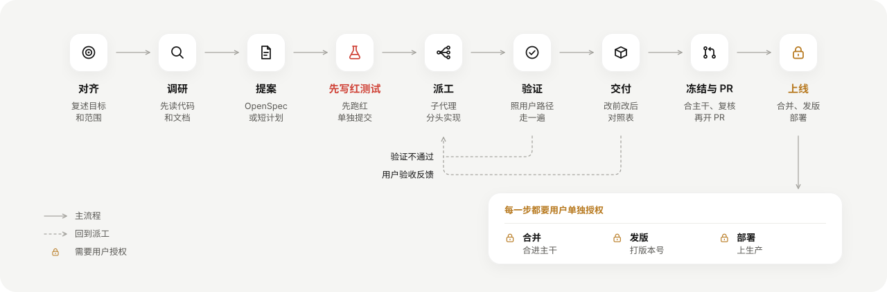
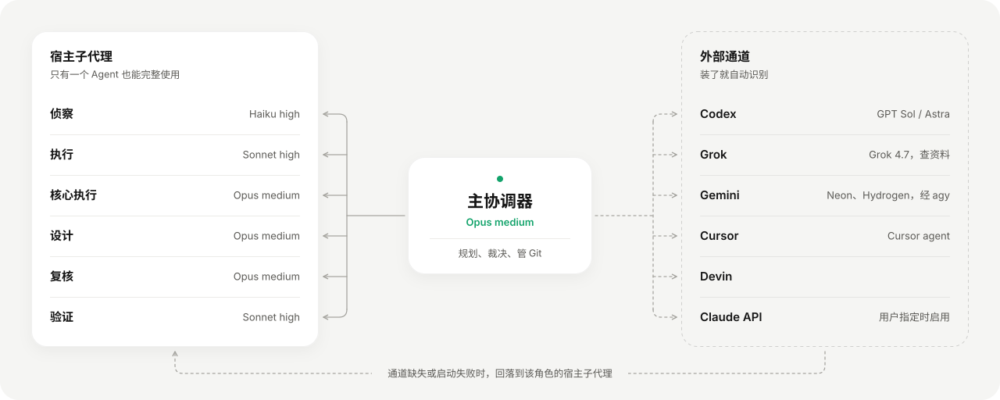

<p align="center">
  <picture>
    <source media="(prefers-color-scheme: dark)" srcset="assets/banner.zh-CN-dark.png">
    
  </picture>
</p>

<p align="center">
  <b>一套与 Agent 无关的工程工作流</b><br>
  Claude Code、Codex、Cursor，或者任何能读技能文件、能派子代理的 Agent 都能用
</p>

<p align="center">
  <a href="LICENSE"></a>
  
  
  
  
</p>

<p align="center">
  <a href="README.md">English</a> · <b>简体中文</b>
</p>

<br>

> [!NOTE]
> **一句话**：你提需求、最后验收，中间的对齐、调研、写规格、先写测试、派子代理实现、在真实浏览器里验证、写交付总结，都由一个主协调器带着一组子代理自动走完。
>
> 它是我们开发 [**豆老板 Bean Boss**](https://beanboss.cn) 八个月来每天在用的工作流。这期间仓库长到 **186 万行源码、6.1 万个测试用例、919 个已合并 PR**。

<br>

**目录**　[是什么](#是什么) · [安装](#安装) · [一个完整案例](#一个完整案例) · [深入：设计与实现](#深入设计与实现) · [路线图](#路线图) · [致谢](#致谢)

<br>

## 是什么

BeanStack 是一份**技能（Agent Skill）**：一个 `SKILL.md` 入口，加 11 份按需读取的参考文档和几个脚本。它不绑定某个 Agent。主协调器读了它，就知道一次任务该怎么拆、派给谁、用什么证明做完了。

<p align="center"></p>

**运行逻辑一共六步：**

| | 阶段 | 做什么 |
|:-:|---|---|
| 1 | **对齐** | 复述目标和最小改动，给出你描述里对应的专业术语，写下验收时用什么来证明 |
| 2 | **调研 → 提案** | 子代理并行读代码、查社区做法；方案清楚后写成 [OpenSpec](https://github.com/Fission-AI/OpenSpec) 提案 |
| 3 | **先写会红的测试** | 行为改动先写一条失败的测试，单独提交 |
| 4 | **派工实现** | 按 tasks 拆成独立单元，派给合适的模型并行做 |
| 5 | **验证** | 只跑受影响的测试；另派一个不是实现者的验证位，在真实浏览器里按你的原话逐条走，截图或录屏 |
| 6 | **交付 → 验收** | 一份只看它就能拍板的总结；你确认后再开 PR。合并、发版、部署各要你单独授权 |

<br>

**用它做出来的产品：**

<p align="center"><a href="https://beanboss.cn"></a></p>

<p align="center"><sub>官网首页与 iPad 界面。网页、iOS、Android 三端都是用这套工作流开发、测试和发版的。</sub></p>

<br>

**它从哪来：**

1. **[OpenSpec](https://github.com/Fission-AI/OpenSpec) 是地基。** BeanStack 最早就是在 OpenSpec 的「提案 → 规格增量 → 归档」上，加了我们自己的派工和验证规则。现在仓库里有 588 份规格、934 个已归档变更，都还管得住。
2. **在豆老板的真实开发里迭代。** 每撞一类事故就改一条规则，能用脚本拦的就写成守卫。踩过的坑比如：子代理删了挡路的测试、验证者就是实现者、门禁红了还合并、性能数字测错。
3. **吸收 [pstack](https://github.com/cursor/plugins/tree/main/pstack) 的验证思路。** Cursor 官方插件里的需求复述、持续优化指标、运行时取证和工程原则，按我们的流程改写后并进来。
4. **Anthropic 官方工程博客**里关于 agent 编排、上下文工程和 Agent Skills 的几篇文章（[见致谢](#致谢)）。
5. **每代新模型都在同一套题上重测**，再决定派工清单改不改。

<br>

---

<br>

## 安装

BeanStack 管的是流程，具体干活要靠几个地基组件。**只装 BeanStack 能跑起来，把下面的组件一起装上才能完整发挥。**

| 组件 | 必要性 | 它负责什么 | 安装 |
|---|---|---|---|
| [**OpenSpec**](https://github.com/Fission-AI/OpenSpec) | 必装 | 管住整个项目。每个需求先写成提案和规格增量，做完归档；AI 改什么、为什么改、改完规格变成什么样，都有据可查。BeanStack 的「提案 → 实现 → 归档」直接建在它上面 | `npm install -g @fission-ai/openspec@latest`，然后在项目里 `openspec init` |
| [**Impeccable**](https://github.com/pbakaus/impeccable) | 做前端必装 | 前端视觉的质量底线：约束排版、字阶、间距和配色，检查自适应布局和性能，让 AI 写出来的界面能被逐条检查，而不是靠感觉 | 在项目根目录 `npx impeccable install`，重启 Agent 后运行 `/impeccable init` |
| [**Playwright CLI**](https://github.com/microsoft/playwright-cli) | 推荐 | 验证位用它打开真实浏览器，按你的原话走用户路径、截图、录屏 | `npm install -g @playwright/cli@latest`，再 `playwright-cli install --skills` |

OpenSpec 要求 Node 22.20 以上。

<br>

**派工用的外部 CLI（可选）**

想把活派给其它厂商的模型，就装对应的命令行工具，并在本机登录好。BeanStack 会自动检测装了哪些，没装的通道直接跳过，回落到宿主自己的子代理。

| 通道 | 适合 | 安装 |
|---|---|---|
| [Codex CLI](https://github.com/openai/codex) | GPT 系列：前端执行、关键后端、异厂复核 | `npm install -g @openai/codex` |
| [Grok CLI](https://docs.x.ai/build/overview) | 互联网调研、读长文、批量只读 | `curl -fsSL https://x.ai/cli/install.sh \| bash` |
| [Antigravity CLI](https://github.com/google-antigravity/antigravity-cli)（`agy`） | Gemini 系列：均衡模式的前端与验证 | `curl -fsSL https://antigravity.google/cli/install.sh \| bash` |
| [Cursor CLI](https://cursor.com/docs/cli/installation)（`agent`） | 用 Cursor 订阅里的模型 | `curl https://cursor.com/install -fsS \| bash` |
| [Devin CLI](https://docs.devin.ai/cli) | 长时间无人值守的任务 | `curl -fsSL https://cli.devin.ai/install.sh \| bash` |

装完运行 `~/.claude/skills/beanstack/scripts/channels.sh`，能看到哪些通道可用。

<br>

### 方式一：交给你的 AI 装（推荐）

把下面这段原样发给你正在用的 Agent（Claude Code、Codex、Cursor 都行）：

```text
请帮我安装 BeanStack 工作流和它的地基组件：
1. 把 https://github.com/qiunai/beanstack 克隆到 ~/.beanstack（已存在就 git pull）。
2. 运行 ~/.beanstack/install.sh，把技能装到用户级目录；已存在的同名技能不要覆盖，先告诉我。
3. 运行 ~/.beanstack/install.sh --project <当前项目根目录>，装入子代理定义和 AGENTS.md 模板。
4. 安装 OpenSpec：npm install -g @fission-ai/openspec@latest，然后在项目根目录运行 openspec init。
5. 如果这个项目有前端：在项目根目录运行 npx impeccable install，并提醒我重启后运行 /impeccable init。
6. 安装 Playwright CLI：npm install -g @playwright/cli@latest，再运行 playwright-cli install --skills。
7. 打开项目里的 AGENTS.md，根据这个项目实际的测试、启动、部署命令，把 <!-- TODO --> 处填好，给我看改动。
8. 运行 ~/.claude/skills/beanstack/scripts/channels.sh，告诉我检测到了哪些外部模型 CLI，缺的列出安装命令，不要替我装。
```

### 方式二：一条命令（npx）

用 [vercel-labs/skills](https://github.com/vercel-labs/skills) 一次装进多个 Agent（需要 Node 22.20+）：

```bash
npx skills add qiunai/beanstack -g -a claude-code codex cursor gemini-cli -y
```

这种方式只装技能本体。子代理定义和 `AGENTS.md` 模板还要跑一次下面的 `install.sh --project`。

### 方式三：克隆后运行安装脚本

```bash
git clone https://github.com/qiunai/beanstack.git ~/.beanstack
~/.beanstack/install.sh                          # 用户级技能：软链到 ~/.claude/skills 与 ~/.agents/skills，已存在不覆盖
~/.beanstack/install.sh --project /path/to/repo  # 项目级：6 个子代理定义 + AGENTS.md 模板
```

加 `--dry-run` 只看会做什么，不落盘。

### 装完怎么用

照常描述需求就行，非简单任务会自动触发 BeanStack。想分摊额度，就说「用均衡模式」（三种模式见[下文](#派工与模型模式)）。

> [!WARNING]
> **外部模型通道默认不弹权限确认。** `dispatch.sh` 是为无人值守派工设计的：grok 带 `--always-approve`，cursor 带 `--trust --force`，devin 用 `dangerous` 模式，agy 跳过权限确认，claude-api 用 `bypassPermissions`。只在你信任的仓库里派，最好放在隔离的 worktree 里。codex 执行仓库钩子需要你显式设 `BEANSTACK_CODEX_TRUST_HOOKS=1`。

<br>

---

<br>

## 一个完整案例

> 需求原话：**「导出图纸失败的时候，用户什么提示都看不到，帮我加上失败提示和重试。」**

整个过程你只出现两次：第 1 步提需求，第 5 步验收。

<br>

**① 对齐**（协调器，Opus medium）

第一条回复不动手，先做三件事：

- **复述目标**：导出失败时给出可理解的原因和「重试」按钮，不改导出成功的路径。
- **补术语**：error state 错误态、retry with backoff 退避重试、toast 轻提示、idempotent 幂等（重试不能导出两份）。
- **写验收证据**：在真实浏览器里断网导出，看到提示；恢复网络点重试，导出成功且只有一份文件。

需求随后拆成核对表落盘，每条写清「要变什么 / 保持什么 / 验收画面」。

<br>

**② 调研 → 提案 → 先写红测试**

- 3 路 Haiku high 并行读代码，追导出入口、错误在哪一层被吞掉、有几个入口共用这条路径；Grok 查社区里成熟的重试交互。
- 协调器逐条核实结论，写成 OpenSpec 提案：`proposal.md`（为什么、方案取舍）、规格增量（新增「导出失败可重试」的场景）、`tasks.md`（每个单元写判据和写入范围）。
- 先写一条会红的测试：模拟导出接口失败，断言界面出现错误态，并且重试只触发一次导出。单独提交。

<br>

**③ 拆解与实现**

- 按 `tasks.md` 并行派工：错误分类和重试逻辑给 Sonnet high（规格清楚的后端），错误态界面给 Opus medium（前端按设计规范实现），同类入口的排查交给另一路。
- 每份任务书都自包含：目标与非目标、`文件:行`、写入范围、验收命令、遇到什么情况停下来问。

<br>

**④ 测试与验证**

- **受影响的单元和集成测试**：证明错误被正确分类、重试幂等、成功路径没变。红测试转绿。
- **端到端用户路径**：派一个**没参与实现**的验证位（Sonnet high），打开真实浏览器，拿你的原话逐条走：断网导出、看提示、恢复网络、点重试、核对只下载了一份。每条判「通过 / 不通过 / 本机测不了」，附截图；保持不变的项附改动前后同一路径的对照图，交互附录屏。

<br>

**⑤ 交付 → 验收**

你收到一份固定格式的总结：

```text
没有需要你拍板的事。结论均为实测。
① 这一轮做了什么：导出失败时显示原因与重试；重试幂等；成功路径不变。
② 修改前后对照
   | 改动项   | 修改前       | 修改后                       | 验证                  |
   | 失败提示 | 无任何反馈   | 显示原因 + 重试按钮          | e2e 截图 3 张，录屏 1 段 |
   | 重试     | 不支持       | 退避重试，只导出一份         | 单测 6 条 + e2e        |
③ 过程中的决定：另外两个导出入口共用同一路径 → 一起修 → 否则同样的问题会再报一次
④ 需要你决定的事：无
```

你看过截图，回一句「可以」，需求就闭环了。之后开 PR；合并要你再说一次。

<br>

这就是 BeanStack 想做到的：**提一次需求，验收一次，中间没有反复拉扯。** 配合设计规范和视觉技能，界面也能一次交付到位。

<br>

---

<br>

## 深入：设计与实现

只想上手的话，读到上面就够了。下面是这套工作流背后的取舍和数据。

<br>

### 真实工程数据

从豆老板仓库里 git 跟踪的文件统计（2026-11-26，不含依赖、构建产物和生成文件）：

| 指标 | 数字 |
|---|---|
| 非测试源码 | **约 186 万行**：网页端 106 万、服务端 39 万、共享包 11 万，其余是脚本和工具 |
| 测试 | **6,330** 个测试文件，约 **61,000** 个用例 |
| OpenSpec | **588** 份能力规格，**934** 个已归档变更 |
| 交付节奏 | **919** 个已合并 PR，16,000+ 次提交，历时 8 个月 |
| 开发方式 | 日常 6–7 个会话并行，每个会话一个 worktree、一个分支、一个 PR；每个会话一个协调器带多个子代理 |

<br>

### 设计理念

每条理念都落在一个具体机制上，不靠模型自觉。

| 理念 | 落到哪个机制 |
|---|---|
| **协调器只裁决和收货** | 主会话出 token 最慢（实测 40–54 tok/s），上下文也最金贵。超过 20 次调用的活派给子代理，主会话只读结论和 `文件:行` |
| **一次做对比单价便宜重要** | 长任务的成本主要是缓存读取，Sonnet 和 Opus 这部分单价相同。拿不准 Sonnet 能否做对，就直接派 Opus medium |
| **证据，不是自述** | 每个结论都标「实测 / 推断 / 未验证」。验证位不能由实现者兼任。只在替身环境验证过的写「未实测」 |
| **测试就是规格** | 先红后绿，红测试单独提交。不跳过、不放宽测试。新守卫要在一次真实的旧错误上变红 |
| **教训写进结构** | 同一个错犯第二次，就按「架构 > 类型 > 断言 > 测试 > lint > 文档」升级成能自动拦下的检查 |
| **停止条件写明，其余自主推进** | 只在产品取舍、不可逆或对外操作、钱/登录/权限语义变化、缺你才有的信息时停下来问 |
| **做不到就说做不到** | 达不到你原话的记「不通过」，只开 PR，不拿降级方案包装成完成 |
| **异厂复核** | 改到钱、登录、权限、迁移、部署时，另找一家厂商的模型复核：不同厂商的盲区不重合 |
| **慢就删源头** | 工作流变慢时先找出慢在哪、删掉它，不叠缓存或证明链 |
| **档位靠参数，不靠提示词** | 想让模型多想或少想，就调 `effort`，不写「仔细思考」 |

<br>

### 质量怎么保证

按改动类型选最便宜、又能真实证明行为的验证方式：

| 改动 | 证明方式 |
|---|---|
| 逻辑、协议、数据、脚本 | **TDD**：先红后绿；脚本测成功和失败两条路径 |
| 可见 UI | 实现者看受影响路由的截图；非实现者的验证位用 [Playwright CLI](https://github.com/microsoft/playwright-cli) 走用户路径 |
| 设计稿还原 | 逐属性对照，视觉值取自设计 token，不手写字面量 |
| 钱、登录、权限、迁移 | 真数据库多角色演练，覆盖失败和回退；再加一家异厂复核 |
| 并发、锁、重试、状态机 | 测试够不着的用 TLA+ / TLC 建模检查 |
| 性能 | 固定负载和设备，每边至少 5 次交替跑，报中位数、范围和限制因素；说不出限制因素就写「无法判断」 |
| 守卫本身 | 新守卫必须在一次真实的旧错误上变红 |

修一个问题前，先对照「同类排查清单」查一遍兄弟问题，列成清单一次修完。

<br>

### 派工与模型模式

<p align="center"></p>

协调器会自动检测本机装了哪些外部 CLI（Codex、Grok、Gemini/Antigravity、Cursor、Devin、Claude API），按角色派过去。没装或启动失败的通道，按优先级换下一个，最后回落到宿主自己的子代理。**只有一个 Agent 也能完整使用。**

模式由你指定，一直生效到你改口：

| | **默认** | **均衡** | **省 Claude** |
|---|---|---|---|
| 适合 | 只有 Claude 订阅，或要最稳的质量 | Claude 和 GPT 都有，想分摊额度 | Claude 额度快见底 |
| 协调器 | Opus 5.5 medium | Opus 5.5 medium | Opus 5.5 medium |
| 前端方案、页面、动效 | Opus medium | Opus medium 与 GPT Astra xhigh 分担（Gemini 可用时 Neon high） | GPT Astra xhigh |
| 前端精准执行 | Sonnet 5.5 high | GPT Sol xhigh（Gemini 可用时 Neon medium） | GPT Sol xhigh |
| 关键后端（钱、登录、迁移、部署） | Opus medium | Opus medium 或 Sol | Sol，协调器亲自读 diff 并实测 |
| 并发、状态机 | Opus medium + Sol 复核 | Sol + Opus medium 复核 | Sol + Astra 或 Grok 复核 |
| 小实现（规格写清） | Haiku 5.5 high | Haiku high 或 Sol | Sol |
| 侦察、批量只读、读长文 | Haiku 5.5 high（可多路） | 同左 | 同左，不够时 Grok |
| 互联网调研 | Grok + Haiku high 两路 | 同左 | Grok |
| 路径验证 | Sonnet high | 同左（Gemini 可用时 Hydrogen medium） | Grok，不够时 Sonnet high |
| 高风险异厂复核 | Opus medium + Sol | Opus medium + Sol 或 Astra | Astra + Grok + 协调器 |

完整路由表和额度兜底顺序见 [model-roster.md](skills/beanstack/references/model-roster.md)。

<details>
<summary><b>为什么是这些档位（评测数据）</b></summary>

<br>

**Opus 5.5 medium 是主力。** 原 10 题全过，中位墙钟 5.6 分钟，在 10 题全过的配置里最快。人工 UI 盲评里一直在第一档：前两轮第一，第三轮只有一个慢 4 倍的模型接近它。high 贵约五成，没变快，分数也没稳定提高；low 在并发题上失败。按我们的使用感受，日常九成左右的活 medium 就够了。Fable 留给大重构和长时间无人值守（这条是经验判断）。

**Sonnet 5.5 和 Haiku 5.5 都用 high。** Sonnet medium 和 high 每题只差几分钱，但 medium 会删挡路的旧测试，做 UI 也不守规范（盲评 27/23 对 33/38）。Haiku high 在闭合题上和 Sonnet high、Opus medium 同分（9.8 / 9.7 / 9.7），7 道题合计费用只有 $0.21，后两者是 $1.39 和 $2.66。它的短板是开放判断，所以它的调研结论一律要核实。Haiku 的 xhigh 不比 high 好，max 贵 5–30 倍。

**低于这些档位，返工会吃掉省下的钱；高于这些档位，等待和额度翻倍，分数却不涨。**

**Grok 适合检索，不适合核心开发。** 它读长文快且便宜，审查误报最少，也通过了最难的并发题；但实现中位要 13 分钟（比 Sol 慢约六成），截图找茬只找到 5/8，文案 7 分，人工盲评里审美明显落后。

方法、题目和每一轮的完整数字见 [docs/model-eval.md](docs/model-eval.md)：6 轮、约 40 道题、400 多次独立运行。UI 题以人工盲评为准。

</details>

<br>

### 我们的真实用量

我们同时开着 **Claude Max 20x、ChatGPT Pro、Google AI Ultra、SuperGrok Heavy、Cursor Ultra** 做高强度实测，Claude 20x 的周额度两三天就会用完。所以很多规则都和额度有关：执行派给便宜的档位（但不低于 high），侦察派 Haiku，均衡模式让 GPT 分担。`scripts/usage-report.mjs` 能拆出你自己的额度去向。

- 换模型、换档位只在阶段之间做；中途切换等于整段上下文按新模型重写一遍。
- 派工的大头不在模型生成：一轮 9.5 小时的会话里，子代理墙钟是生成耗时的 4–5 倍。后台任务一结束就收货，比换更快的模型更管用。

<br>

### 工具选型

| 环节 | 选了什么 | 为什么 |
|---|---|---|
| 规格管理 | [**OpenSpec**](https://github.com/Fission-AI/OpenSpec) | 试过 [Superpowers](https://github.com/obra/superpowers) 等多套方案，最后选了它：提案、规格增量、归档一条线，能和 PR 一一对应，攒到 588 份规格还管得住 |
| 视觉风格 | 自定义 `DESIGN.md` + [**Impeccable**](https://github.com/pbakaus/impeccable) | 先和 AI 一起定好产品风格，写成设计规范。第三方视觉技能推荐 Impeccable：试过 [UI UX Pro Max](https://github.com/nextlevelbuilder/ui-ux-pro-max-skill) 等多个之后，它的细节把控、风格约束和自适应最好 |
| 浏览器验证 | [**Playwright CLI**](https://github.com/microsoft/playwright-cli) | 为编码代理设计，验证位用它走用户路径、截图 |
| 外部模型 | Codex CLI、Grok CLI、Antigravity、Cursor agent、Devin | 统一由 `scripts/dispatch.sh` 后台启动，写派工账本，识别额度耗尽后自动换通道 |

<br>

### 在其它 Agent 上用，或者只借思想

- **技能本身是纯文本。** 任何能读 `SKILL.md` 或 `AGENTS.md` 的 Agent 都能按它走流程。Codex 会读 `~/.agents/skills`，当协调器时用它自己的子代理。
- **没有子代理的宿主**，可以用 `dispatch.sh` 把活派给别的模型 CLI，相当于把多个模型聚合成一支团队。
- **只想借思想也行。** 对齐三步、需求核对表、先红后绿、验证位不能是实现者、停止条件、交付总结格式，这些都能单独抽出来，改成适合你团队的版本。

<br>

### 仓库结构

```
beanstack/
├── skills/beanstack/      技能本体：SKILL.md + references/（11 份）+ scripts/（派工启动器与统计脚本）
├── templates/             AGENTS.md 项目基线模板 + agents/ 下 6 个子代理定义
├── docs/model-eval.md     评测摘要
├── assets/                配图
└── install.sh
```

<br>

---

<br>

## 路线图

当前 **v0.1.0**。技能正文目前是中文，英文版排在 v0.2。

- **v0.2**：英文版技能；开源模式切换钩子、需求核对表工具
- **v0.3**：开源评测框架，让你在自己的仓库上重跑模型评测；接入 DeepSeek 等更多通道
- **v0.4**：打包成插件，一条命令安装
- **v1.0**：模型清单与路由表格式稳定

详见 [ROADMAP.md](ROADMAP.md)。

<br>

## 致谢

- [**OpenSpec**](https://github.com/Fission-AI/OpenSpec)：BeanStack 的地基
- [cursor/plugins · pstack](https://github.com/cursor/plugins/tree/main/pstack)（MIT）：需求复述、工程原则、持续优化、运行时取证
- Anthropic 工程博客：[Building effective agents](https://www.anthropic.com/engineering/building-effective-agents) · [How we built our multi-agent research system](https://www.anthropic.com/engineering/multi-agent-research-system) · [Effective context engineering for AI agents](https://www.anthropic.com/engineering/effective-context-engineering-for-ai-agents) · [Writing effective tools for agents](https://www.anthropic.com/engineering/writing-tools-for-agents) · [Equipping agents for the real world with Agent Skills](https://www.anthropic.com/engineering/equipping-agents-for-the-real-world-with-agent-skills) · [Best practices for Claude Code](https://code.claude.com/docs/en/best-practices)
- [Impeccable](https://github.com/pbakaus/impeccable) · [Playwright CLI](https://github.com/microsoft/playwright-cli)

<br>

## 许可证

[MIT](LICENSE)。用 BeanStack 做出了东西，欢迎开 issue 告诉我们。
